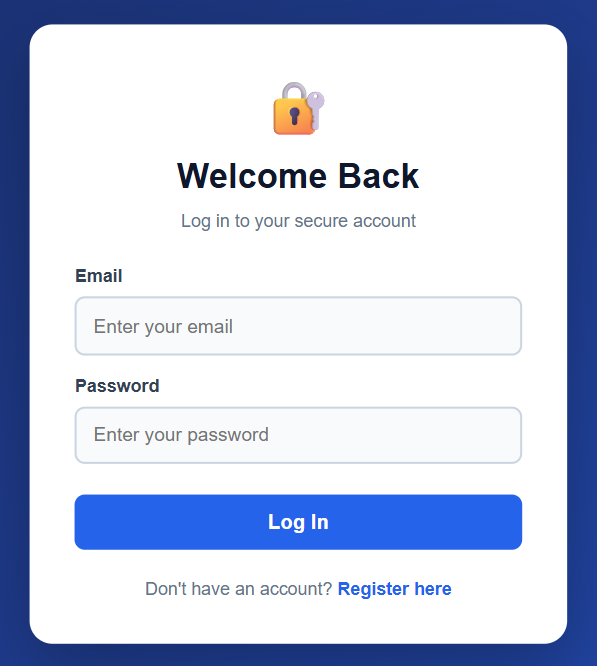
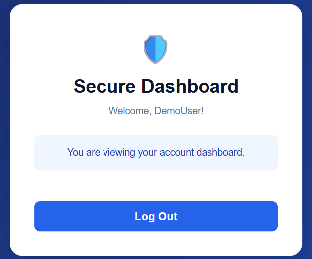

# 🔐 Secure Login System

A web-based authentication application developed using Node.js, Express.js, and SQLite. This project provides secure user registration and login with password hashing, session management, and protection against common web attacks.

## ✨ Features

- User registration and login
- Secure password hashing using bcrypt
- Session-based authentication
- CSRF protection
- Login and registration rate limiting
- Input validation
- SQLite database integration
- Logout functionality
- Responsive user interface

## 🛠️ Technologies Used

- **Frontend:** HTML, CSS, JavaScript
- **Backend:** Node.js, Express.js
- **Database:** SQLite
- **Security:** bcrypt, express-session, Helmet, express-rate-limit

## 📸 Screenshots

### Login Page


### Secure Dashboard


## 📁 Project Structure

```text
Secure-Login-System/
├── public/
│   ├── index.html
│   ├── register.html
│   ├── dashboard.html
│   ├── style.css
│   └── script.js
├── database.js
├── server.js
├── package.json
├── package-lock.json
├── .gitignore
└── README.md
```

## ⚙️ Installation and Setup

### Prerequisites

- Node.js and npm installed
- Git installed

### Steps

**1. Clone the repository**

```bash
git clone https://github.com/deepika13j/Secure-Login-System.git
```

**2. Navigate to the project directory**

```bash
cd Secure-Login-System
```

**3. Install dependencies**

```bash
npm install
```

**4. Create a `.env` file** in the project root:

```env
PORT=3000
SESSION_SECRET=replace_with_a_random_secret
```

Replace the example session secret with a securely generated random secret of at least 32 characters.

**5. Start the application**

```bash
npm start
```

**6. Open the application**

Visit `http://localhost:3000` in your browser.

## 🔒 Security Notes

- Passwords are hashed before being stored.
- Authentication uses server-side sessions.
- CSRF tokens help protect state-changing requests.
- Rate limiting helps reduce repeated login attempts.
- Environment variables and database files should not be committed to GitHub.
- Production deployment requires HTTPS, secure cookie settings, and a persistent session store.

## 🎯 Project Objective

The objective of this project is to understand web authentication, password security, session handling, database integration, and basic security practices in web application development.

## 📄 License

This project is available for educational and learning purposes.
